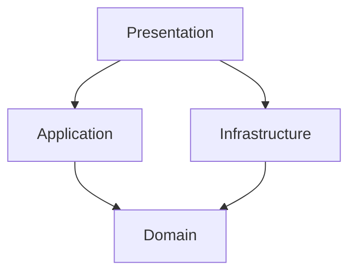

# TaskManager

Консольний застосунок для обліку завдань, створений у межах лабораторної роботи №5 з дисципліни «Сучасні технології проєктування».

## Можливості
- створення завдань;
- перегляд усіх завдань;
- позначення завдання як виконаного;
- збереження даних у JSON-файлі `tasks.json`.

## Архітектура
- **Domain** — сутність `TaskItem` та інтерфейс `ITaskRepository`.
- **Application** — сценарії створення, перегляду та завершення завдань.
- **Infrastructure** — реалізація `JsonTaskRepository`, яка працює з JSON-файлом.
- **Presentation** — консольне меню та ручне складання залежностей (Dependency Injection).



Application залежить від абстракції `ITaskRepository` із Domain, а не від конкретного сховища. Presentation створює `JsonTaskRepository` і передає його use case через конструктори.

## Запуск
Потрібен .NET 8 SDK або новіший SDK, що підтримує `net8.0`.

```bash
dotnet restore
dotnet build
dotnet run
```

Дані зберігаються у `tasks.json` у робочій папці запуску.
